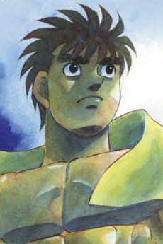

<div align="center">

# 🦍 Gorila Squad

### O time de agentes de IA da Gorila Software House

**15 agentes especialistas · 15 slash commands · 38 skills sob demanda · 63 playbooks de pentest**
**Um comando de instalação. Claude Code e Cursor.**


<br/>

<table>
  <tr>
    <td align="center"></td>
    <td align="center"></td>
    <td align="center"></td>
    <td align="center"></td>
    <td align="center"></td>
    <td align="center"></td>
    <td align="center"></td>
  </tr>
  <tr>
    <td align="center"></td>
    <td align="center"></td>
    <td align="center"></td>
    <td align="center"></td>
    <td align="center"></td>
    <td align="center"></td>
    <td align="center"></td>
  </tr>
</table>

<br/>

<table>
  <tr>
    <td align="right"><b>🚀 Começar</b></td>
    <td align="center"><a href="#-quick-start">⚡ Quick Start</a></td>
    <td align="center"><a href="#-como-usar">🎮 Como usar</a></td>
    <td align="center"><a href="#-atualizar-o-squad">🔄 Atualizar</a></td>
  </tr>
  <tr>
    <td align="right"><b>💡 Entender</b></td>
    <td align="center"><a href="#-a-promessa">💥 A promessa</a></td>
    <td align="center"><a href="#-por-que-o-gorila-squad">🤔 Por quê</a></td>
    <td align="center"><a href="#-fluxo-de-trabalho">🧭 Fluxo</a></td>
  </tr>
  <tr>
    <td align="right"><b>⚙️ Recursos</b></td>
    <td align="center"><a href="#-conheça-o-time">👥 O time</a></td>
    <td align="center"><a href="#-skills-sob-demanda">🧩 Skills</a></td>
    <td align="center"><a href="#️-nezuko--63-playbooks-de-segurança">🛡️ Segurança</a></td>
  </tr>
  <tr>
    <td align="right"><b>📦 Projeto</b></td>
    <td align="center"><a href="#-estrutura-do-repositório">🗂️ Estrutura</a></td>
    <td align="center"><a href="#-adicionando-conhecimento-novo">➕ Contribuir</a></td>
    <td align="center"><a href="#-agradecimentos">🙏 Créditos</a></td>
  </tr>
</table>

</div>

---

## ⚡ Quick Start

Pré-requisitos: [Claude Code](https://claude.ai/code) instalado e Git com acesso ao repositório.

```bash
git clone git@github.com:rotteny/gorila-squad.git
cd gorila-squad
./setup.sh                        # Claude Code (global)
./setup.sh /caminho/do/projeto    # Claude Code + Cursor Rules no projeto
```

Pronto. Abra o Claude Code e chame quem você precisa:

```
/light  implementa o módulo de assinaturas completo
```

O `setup.sh` instala, nesta ordem: agentes em `~/.claude/agents`, playbooks de segurança em `~/.claude/strix-agentes`, commands em `~/.claude/commands`, skills em `~/.claude/skills`, a seção do squad no `~/.claude/CLAUDE.md` global (entre marcadores, preservando o resto do arquivo) e, se você passar um projeto, as Cursor Rules em `.cursor/rules`.

---

## 💥 A promessa

| | |
|---|---|
| 👥 **15 especialistas** | Backend, frontend, banco, QA, segurança, DevOps, mobile, Python/Node, arquitetura, dados, planejamento, social media, jurídico e um agente que cria outros agentes |
| 🎯 **1 coordenador** | O `LIGHT` recebe a tarefa multi-domínio e orquestra os especialistas certos |
| 🧩 **38 skills sob demanda** | Conhecimento periférico só entra no contexto quando a tarefa pede |
| 🛡️ **63 playbooks de pentest** | `NEZUKO` orquestra a base de segurança do [strix](https://github.com/usestrix/strix) |
| 🖥️ **2 ambientes** | Claude Code (global) e Cursor (por projeto) com a mesma equipe |
| 📉 **−26% de contexto** | Agentes enxutos: o núcleo fica no agente, o resto vira skill |

---

## 🤔 Por que o Gorila Squad?

| Dor | Como o squad resolve |
|---|---|
| Prompt genérico responde tudo mais ou menos | Cada agente tem **domínio, stack e padrões** definidos — `ESCANOR` é PHP/Laravel, não "um assistente de código" |
| Tarefa grande vira conversa sem fim | `SHIKAMARU` quebra em plano, `LIGHT` executa orquestrando os especialistas |
| Contexto inchado e caro a cada invocação | Núcleo no agente, periferia em **skills carregadas sob demanda** |
| Cada dev configura o assistente do seu jeito | Um `setup.sh`, mesma equipe e mesmos padrões para todo mundo |
| Segurança vira "depois a gente vê" | `NEZUKO` com 63 playbooks cobrindo OWASP, frameworks, cloud e protocolos |
| Faltou um especialista | `ARQUITETO-DE-AGENTES` cria o agente novo no mesmo formato dos existentes |

---

## 🧭 Fluxo de trabalho

```
Ideia → SHIKAMARU (planeja) → LIGHT (executa orquestrando especialistas) → Entrega
```

O `LIGHT` pode acionar qualquer agente diretamente quando a tarefa já está clara.

```
              ┌────────────┐
   Ideia ───▶ │ SHIKAMARU  │  plano, requisitos, estimativa
              └─────┬──────┘
                    ▼
              ┌────────────┐
              │   LIGHT    │  orquestra
              └─┬──┬──┬──┬─┘
   ┌────────────┘  │  │  └────────────┐
   ▼               ▼  ▼               ▼
ESCANOR · BULMA · IPPO · GON   LEVI · NEZUKO · SAITAMA   KURAMA · RYUK · …
 (construir)                    (validar e entregar)      (decidir e medir)
```

---

## 👥 Conheça o time

<table>
  <tr>
    <td align="center" width="25%">
      <br/>
      <b>LIGHT</b><br/><sub>Light Yagami · Death Note</sub><br/>
      Coordenador / Orquestrador de agentes
    </td>
    <td align="center" width="25%">
      <br/>
      <b>SHIKAMARU</b><br/><sub>Shikamaru Nara · Naruto</sub><br/>
      Project Management — entrega o plano ao Light
    </td>
    <td align="center" width="25%">
      <br/>
      <b>ESCANOR</b><br/><sub>Escanor · Nanatsu no Taizai</sub><br/>
      PHP + Laravel + API Docs
    </td>
    <td align="center" width="25%">
      <br/>
      <b>BULMA</b><br/><sub>Bulma · Dragon Ball</sub><br/>
      Frontend (Vue, React, Tailwind) + UX Research
    </td>
  </tr>
  <tr>
    <td align="center">
      <br/>
      <b>IPPO</b><br/><sub>Ippo Makunouchi · Hajime no Ippo</sub><br/>
      Banco de dados (PostgreSQL, MySQL, Redis)
    </td>
    <td align="center">
      <br/>
      <b>LEVI</b><br/><sub>Levi Ackerman · Attack on Titan</sub><br/>
      QA, testes e qualidade de código
    </td>
    <td align="center">
      <br/>
      <b>NEZUKO</b><br/><sub>Nezuko Kamado · Demon Slayer</sub><br/>
      Segurança, OWASP e pentest
    </td>
    <td align="center">
      <br/>
      <b>SAITAMA</b><br/><sub>Saitama · One Punch Man</sub><br/>
      DevOps + SRE
    </td>
  </tr>
  <tr>
    <td align="center">
      <br/>
      <b>GON</b><br/><sub>Gon Freecss · Hunter x Hunter</sub><br/>
      Mobile (React Native, Flutter)
    </td>
    <td align="center">
      <br/>
      <b>URARAKA</b><br/><sub>Ochaco Uraraka · My Hero Academia</sub><br/>
      Python + Node.js
    </td>
    <td align="center">
      <br/>
      <b>KURAMA</b><br/><sub>Kurama · Yu Yu Hakusho</sub><br/>
      Arquitetura de Software e DDD
    </td>
    <td align="center">
      <br/>
      <b>RYUK</b><br/><sub>Ryuk · Death Note</sub><br/>
      Data e Business Intelligence
    </td>
  </tr>
  <tr>
    <td align="center">
      <br/>
      <b>DAZAI</b><br/><sub>Osamu Dazai · Bungou Stray Dogs</sub><br/>
      Social media, conteúdo e marketing
    </td>
    <td align="center">
      <br/>
      <b>NARUHODO</b><br/><sub>Naruhodo · Ace Attorney</sub><br/>
      Jurídico e LGPD
    </td>
    <td align="center">
      🛠️<br/>
      <b>ARQUITETO-DE-AGENTES</b><br/><sub>sem personagem</sub><br/>
      Cria novos agentes no formato do squad
    </td>
    <td></td>
  </tr>
</table>

<sub>Imagens dos personagens obtidas via [AniList](https://anilist.co); os direitos pertencem aos respectivos autores e estúdios. Uso ilustrativo, sem fins comerciais.</sub>

### Tabela rápida

| Agente | Personagem | Domínio | Command |
|--------|-----------|---------|---------|
| **Light** | Light Yagami — Death Note | Coordenador / Orquestrador | `/light` |
| **Shikamaru** | Shikamaru — Naruto | Project Management | `/shikamaru` |
| **Escanor** | Escanor — Nanatsu no Taizai | PHP + Laravel + API Docs | `/escanor` |
| **Bulma** | Bulma — Dragon Ball | Frontend + UX Research | `/bulma` |
| **Ippo** | Ippo — Hajime no Ippo | Banco de dados | `/ippo` |
| **Levi** | Levi — Attack on Titan | QA, testes e qualidade | `/levi` |
| **Nezuko** | Nezuko — Demon Slayer | Segurança e OWASP | `/nezuko` |
| **Saitama** | Saitama — One Punch Man | DevOps + SRE | `/saitama` |
| **Gon** | Gon — Hunter x Hunter | Mobile | `/gon` |
| **Uraraka** | Uraraka — My Hero Academia | Python + Node.js | `/uraraka` |
| **Kurama** | Kurama — Yu Yu Hakusho | Arquitetura e DDD | `/kurama` |
| **Ryuk** | Ryuk — Death Note | Data e BI | `/ryuk` |
| **Dazai** | Osamu Dazai — Bungou Stray Dogs | Social media, conteúdo e marketing | `/dazai` |
| **Naruhodo** | Naruhodo — Ace Attorney | Jurídico / LGPD | `/naruhodo` |
| **Arquiteto de Agentes** | — | Criação de novos agentes | `/arquiteto-de-agentes` |

---

## 🎮 Como usar

```
/light      implementa o módulo de assinaturas completo
/shikamaru  planeja a feature de relatórios de agendamentos
/escanor    cria um endpoint de webhook com validação de assinatura
/bulma      cria um componente de calendário responsivo com PrimeVue
/ippo       otimiza as queries de relatório que estão lentas
/levi       escreve testes Pest para o módulo de planos
/nezuko     faz security review do fluxo de autenticação
/saitama    configura o GitHub Actions com deploy automático
/gon        cria a tela de agendamento no app React Native
/uraraka    cria um script Python de importação de clientes via CSV
/kurama     define a arquitetura do módulo de notificações
/ryuk       cria um relatório de agendamentos por período
/dazai      escreve o roteiro de um Reels sobre o lançamento
/naruhodo   gera a política de privacidade do app conforme a LGPD
/arquiteto-de-agentes  cria um agente especialista em Terraform
```

---

## 🧩 Skills sob demanda

Cada agente carrega o arquivo dele inteiro em contexto toda vez que é invocado. Para não pagar por conhecimento que a tarefa não usa, o **núcleo fica no agente** e o **periférico virou skill**, carregada só quando o assunto aparece.

Exemplo: o `ESCANOR` mantém PHP 8.3/8.4 e Laravel 11/12/13 no próprio arquivo — isso *é* ele. Já a referência de OpenAPI/Swagger saiu para uma skill; ele a invoca apenas quando a tarefa é documentar uma API.

| Agente | Skills que aciona |
|---|---|
| `ESCANOR` | `php-laravel-ref` · `php-code-style` · `api-docs-ref` |
| `BULMA` | `frontend-ref` · `react-ref` · `ux-research-design` |
| `IPPO` | `db-engines-ref` · `db-extras` |
| `LEVI` | `testes-frontend-ts` · `php-code-style` |
| `NEZUKO` | `owasp-laravel-ref` · `refs-de-ataque` · `api-docs-ref` · `infra-k8s-sre` · `db-extras` |
| `SAITAMA` | `devops-ref` · `infra-k8s-sre` |
| `GON` | `mobile-ref` |
| `URARAKA` | `python-node-ref` · `api-docs-ref` |
| `KURAMA` | `arch-ddd-ref` · `api-docs-ref` |
| `RYUK` | `data-bi-ref` · `db-extras` |
| `SHIKAMARU` | `pm-ref` · `templates-doc-pm` |
| `LIGHT` | `metricas-gestao` (DORA, RICE, MoSCoW, RACI) |
| `DAZAI` | `post-writer` · `post-formatter` · `post-scorer` · `reels-scripting` · `content-matrix` · `niche-research` · `voice-builder` · `gemini-carousel` · `gemini-infographic` · `youtube-thumbnail` · `graphic-designer` · `hook-generator` |
| `NARUHODO` | `legal-br` · `leis-br` · `gerador-lgpd` |
| `ARQUITETO-DE-AGENTES` | `arch-ddd-ref` · `templates-doc-pm` |

Skills de processo, usadas por qualquer agente: `systematic-debugging`, `verification-before-completion`, `writing-skills`.

**Impacto medido (nos 12 agentes originais):** caíram de 115.296 para 95.252 caracteres — **−26%**, cerca de 5.700 tokens fora do contexto base de toda invocação. Os cortes maiores: `SAITAMA` −41%, `BULMA` −33%, `SHIKAMARU` −25%.

As skills usam `user-invocable: false`: são invocadas pelos agentes, não aparecem no seu menu `/`. Os agentes que as consomem têm `Skill` na lista `tools:` do frontmatter.

---

## 🛡️ NEZUKO — 63 playbooks de segurança

A `NEZUKO` não é só um agente de OWASP: ela orquestra uma biblioteca de playbooks de pentest instalada em `~/.claude/strix-agentes/`, organizada por tipo de alvo e técnica:

| Pasta | Cobre |
|---|---|
| `vulnerabilities/` | SQLi, XSS, IDOR, SSRF, SSTI, RCE, XXE, JWT… |
| `frameworks/` · `technologies/` | Teste específico por framework e tecnologia |
| `cloud/` · `infra/` · `protocols/` | Cloud, infraestrutura e protocolos |
| `reconnaissance/` · `scan_modes/` | Reconhecimento e modos de varredura |
| `tooling/` · `coordination/` | Ferramentas e coordenação entre playbooks |
| `custom/` | Playbooks red team da squad: fuzzing, SAST, privesc, CVE de dependências, mobile, rede, cripto, specs de API |

Origem e licença dos playbooks em [`strix agentes/ATTRIBUTION.md`](strix%20agentes/ATTRIBUTION.md).

---

## 🗂️ Estrutura do repositório

```
gorila-squad/
├── claude-agents/     # 15 agentes (frontmatter + persona + núcleo de conhecimento)
├── claude-commands/   # 15 slash commands (/light, /escanor, ...)
├── claude-skills/     # 38 skills de referência carregadas sob demanda
├── cursor-rules/      # regras equivalentes para o Cursor (.mdc)
├── strix agentes/     # playbooks de segurança orquestrados pela NEZUKO
├── docs/characters/   # rosto de cada personagem usado neste README
├── CLAUDE.md          # regras de delegação do squad
└── setup.sh           # instalador
```

---

## 🔄 Atualizar o squad

```bash
git pull
./setup.sh                        # atualiza Claude Code
./setup.sh /caminho/do/projeto    # atualiza também o Cursor
```

---

## ➕ Adicionando conhecimento novo

Antes de engordar um agente, pergunte: **isso é o núcleo dele, ou é periférico?**

- **Núcleo** (o que ele é, usado na maioria das tarefas) → direto no `claude-agents/<agente>.md`
- **Periférico** (stack alternativa, tema ocasional, material de referência) → nova skill em `claude-skills/<nome>/SKILL.md`, mais uma linha na tabela "Conhecimento sob demanda" no fim do arquivo do agente
- **Domínio inteiro que não existe no squad** → chame `/arquiteto-de-agentes` e ele monta agente, command e catálogo no formato certo

---

## 🙏 Agradecimentos

- [**strix**](https://github.com/usestrix/strix) (Apache-2.0) — base dos playbooks de segurança. Licença e aviso em `strix agentes/STRIX-LICENSE` e `strix agentes/STRIX-NOTICE`.
- [**OmniRoute**](https://github.com/cheaper-inference/OmniRoute) — inspiração para a estrutura deste README.
- [**AniList**](https://anilist.co) — fonte das imagens dos personagens.
- Autores e estúdios de Death Note, Naruto, Nanatsu no Taizai, Dragon Ball, Hajime no Ippo, Attack on Titan, Demon Slayer, One Punch Man, Hunter x Hunter, My Hero Academia, Yu Yu Hakusho, Bungou Stray Dogs e Ace Attorney, pelos personagens que dão cara ao time.

<div align="center">

**Feito pela Gorila Software House 🦍**

</div>
