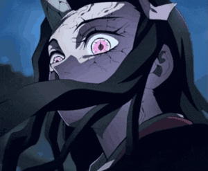
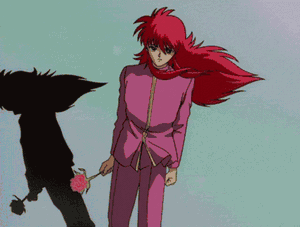

<div align="center">

# 🦍 Gorila Squad

### O time de agentes de IA da Gorila Software House

**12 agentes especialistas · 12 slash commands · 8 skills sob demanda**

**Um comando de instalação. Claude Code e Cursor.**


<br/>



<br/>

<table>
  <tr>
    <td align="right"><b>🚀 Começar</b></td>
    <td align="center"><a href="#-quick-start">⚡ Quick Start</a></td>
    <td align="center"><a href="#-como-usar">🎮 Como usar</a></td>
    <td align="center"><a href="#-atualizar-o-squad">🔄 Atualizar</a></td>
  </tr>
  <tr>
    <td align="right"><b>💡 Entender</b></td>
    <td align="center"><a href="#-a-promessa">💥 A promessa</a></td>
    <td align="center"><a href="#-por-que-o-gorila-squad">🤔 Por quê</a></td>
    <td align="center"><a href="#-fluxo-de-trabalho">🧭 Fluxo</a></td>
  </tr>
  <tr>
    <td align="right"><b>⚙️ Recursos</b></td>
    <td align="center"><a href="#-conheça-o-time">👥 O time</a></td>
    <td align="center"><a href="#-skills-sob-demanda">🧩 Skills</a></td>
    <td align="center"><a href="#-estrutura-do-repositório">🗂️ Estrutura</a></td>
  </tr>
</table>

</div>

---

## ⚡ Quick Start

Pré-requisitos: [Claude Code](https://claude.ai/code) instalado e Git com acesso ao repositório.

```bash
git clone git@github.com:rotteny/gorila-squad.git
cd gorila-squad
./setup.sh                        # Claude Code (global)
./setup.sh /caminho/do/projeto    # Claude Code + Cursor Rules no projeto
```

Pronto. Abra o Claude Code e chame quem você precisa:

```
/light  implementa o módulo de assinaturas completo
```

O `setup.sh` instala, nesta ordem: agentes em `~/.claude/agents`, commands em `~/.claude/commands`, skills em `~/.claude/skills`, a seção do squad no `~/.claude/CLAUDE.md` global (entre marcadores, preservando o resto do arquivo) e, se você passar um projeto, as Cursor Rules em `.cursor/rules`.

---

## 💥 A promessa

| | |
|---|---|
| 👥 **12 especialistas** | Backend, frontend, banco, QA, segurança, DevOps, mobile, Python/Node, arquitetura, dados e planejamento |
| 🎯 **1 coordenador** | O `LIGHT` recebe a tarefa multi-domínio e orquestra os especialistas certos |
| 🧩 **8 skills sob demanda** | Conhecimento periférico só entra no contexto quando a tarefa pede |
| 🖥️ **2 ambientes** | Claude Code (global) e Cursor (por projeto) |
| 📉 **−26% de contexto** | Agentes enxutos: o núcleo fica no agente, o resto vira skill |

---

## 🤔 Por que o Gorila Squad?

| Dor | Como o squad resolve |
|---|---|
| Prompt genérico responde tudo mais ou menos | Cada agente tem **domínio, stack e padrões** definidos — `ESCANOR` é PHP/Laravel, não "um assistente de código" |
| Tarefa grande vira conversa sem fim | `SHIKAMARU` quebra em plano, `LIGHT` executa orquestrando os especialistas |
| Contexto inchado e caro a cada invocação | Núcleo no agente, periferia em **skills carregadas sob demanda** |
| Cada dev configura o assistente do seu jeito | Um `setup.sh`, mesma equipe e mesmos padrões para todo mundo |
| Segurança vira "depois a gente vê" | `NEZUKO` dedicada a OWASP, revisão de auth e hardening |

---

## 🧭 Fluxo de trabalho

```
Ideia → SHIKAMARU (planeja) → LIGHT (executa orquestrando especialistas) → Entrega
```

O `LIGHT` pode acionar qualquer agente diretamente quando a tarefa já está clara.



---

## 👥 Conheça o time

<table>
  <tr>
    <td align="center" width="25%">
      <br/>
      <b>LIGHT</b><br/><sub>Light Yagami · Death Note</sub><br/>
      Coordenador / Orquestrador de agentes
    </td>
    <td align="center" width="25%">
      <br/>
      <b>SHIKAMARU</b><br/><sub>Shikamaru Nara · Naruto</sub><br/>
      Project Management — entrega o plano ao Light
    </td>
    <td align="center" width="25%">
      <br/>
      <b>ESCANOR</b><br/><sub>Escanor · Nanatsu no Taizai</sub><br/>
      PHP + Laravel + API Docs
    </td>
    <td align="center" width="25%">
      <br/>
      <b>BULMA</b><br/><sub>Bulma · Dragon Ball</sub><br/>
      Frontend (Vue, React, Tailwind) + UX Research
    </td>
  </tr>
  <tr>
    <td align="center">
      <br/>
      <b>IPPO</b><br/><sub>Ippo Makunouchi · Hajime no Ippo</sub><br/>
      Banco de dados (PostgreSQL, MySQL, Redis)
    </td>
    <td align="center">
      <br/>
      <b>LEVI</b><br/><sub>Levi Ackerman · Attack on Titan</sub><br/>
      QA, testes e qualidade de código
    </td>
    <td align="center">
      <br/>
      <b>NEZUKO</b><br/><sub>Nezuko Kamado · Demon Slayer</sub><br/>
      Segurança e OWASP
    </td>
    <td align="center">
      <br/>
      <b>SAITAMA</b><br/><sub>Saitama · One Punch Man</sub><br/>
      DevOps + SRE
    </td>
  </tr>
  <tr>
    <td align="center">
      <br/>
      <b>GON</b><br/><sub>Gon Freecss · Hunter x Hunter</sub><br/>
      Mobile (React Native, Flutter)
    </td>
    <td align="center">
      <br/>
      <b>URARAKA</b><br/><sub>Ochaco Uraraka · My Hero Academia</sub><br/>
      Python + Node.js
    </td>
    <td align="center">
      <br/>
      <b>KURAMA</b><br/><sub>Kurama · Yu Yu Hakusho</sub><br/>
      Arquitetura de Software e DDD
    </td>
    <td align="center">
      <br/>
      <b>RYUK</b><br/><sub>Ryuk · Death Note</sub><br/>
      Data e Business Intelligence
    </td>
  </tr>
</table>

<sub>Rostos via [AniList](https://anilist.co) e GIFs via [GIFDB](https://gifdb.com); os direitos pertencem aos respectivos autores e estúdios. Uso ilustrativo, sem fins comerciais.</sub>

### Tabela rápida

| Agente | Personagem | Domínio | Command |
|--------|-----------|---------|---------|
| **Light** | Light Yagami — Death Note | Coordenador / Orquestrador de agentes | `/light` |
| **Shikamaru** | Shikamaru — Naruto | Project Management → entrega plano ao Light | `/shikamaru` |
| **Escanor** | Escanor — Nanatsu no Taizai | PHP + Laravel + API Docs | `/escanor` |
| **Bulma** | Bulma — Dragon Ball | Frontend (Vue, React, Tailwind) + UX Research | `/bulma` |
| **Ippo** | Ippo — Hajime no Ippo | Banco de dados (PostgreSQL, MySQL, Redis) | `/ippo` |
| **Levi** | Levi — Attack on Titan | QA, testes e qualidade de código | `/levi` |
| **Nezuko** | Nezuko — Demon Slayer | Segurança e OWASP | `/nezuko` |
| **Saitama** | Saitama — One Punch Man | DevOps + SRE | `/saitama` |
| **Gon** | Gon — Hunter x Hunter | Mobile (React Native, Flutter) | `/gon` |
| **Uraraka** | Uraraka — My Hero Academia | Python + Node.js | `/uraraka` |
| **Kurama** | Kurama — Yu Yu Hakusho | Arquitetura de Software e DDD | `/kurama` |
| **Ryuk** | Ryuk — Death Note | Data e Business Intelligence | `/ryuk` |

---

## 🎮 Como usar

```
/light      implementa o módulo de assinaturas completo
/shikamaru  planeja a feature de relatórios de agendamentos
/escanor    cria um endpoint de webhook com validação de assinatura
/bulma      cria um componente de calendário responsivo com PrimeVue
/ippo       otimiza as queries de relatório que estão lentas
/levi       escreve testes Pest para o módulo de planos
/nezuko     faz security review do fluxo de autenticação
/saitama    configura o GitHub Actions com deploy automático
/gon        cria a tela de agendamento no app React Native
/uraraka    cria um script Python de importação de clientes via CSV
/kurama     define a arquitetura do módulo de notificações
/ryuk       cria um relatório de agendamentos por período
```

---

## 🧩 Skills sob demanda

Cada agente carrega o arquivo dele inteiro em contexto toda vez que é invocado. Para não pagar por conhecimento que a tarefa não usa, o **núcleo fica no agente** e o **periférico virou skill**, carregada só quando o assunto aparece.

Exemplo: o `ESCANOR` mantém PHP 8.3/8.4 e Laravel 11/12/13 no próprio arquivo — isso *é* ele. Já a referência de OpenAPI/Swagger saiu para uma skill; ele a invoca apenas quando a tarefa é documentar uma API.

> 🧠 Arquitetura de skills sob demanda desenvolvida por **Hélio Vinícius**.

| Skill | Conteúdo | Agente que aciona |
|---|---|---|
| `api-docs-ref` | OpenAPI 3.1, Scramble vs L5-Swagger vs Scribe, Sanctum no spec, contract-first | `ESCANOR` |
| `infra-k8s-sre` | Kubernetes, stack LGTM, IaC (Terraform/Pulumi/OpenTofu), SLI/SLO/error budget | `SAITAMA` |
| `react-ref` | React 19: Server Components, Actions, `use()`, compilador | `BULMA` |
| `ux-research-design` | Wireframes, fluxos, usability testing, WCAG 2.2, design tokens | `BULMA` |
| `db-extras` | MySQL 9.x, PgBouncer vs Supavisor, pgvector | `IPPO` |
| `testes-frontend-ts` | Vitest 2/3, Playwright 1.44+, TypeScript strict mode | `LEVI` |
| `templates-doc-pm` | Templates de PRD, RFC e ADR; ClickUp; feature flags | `SHIKAMARU` |
| `metricas-gestao` | DORA Metrics, RICE, MoSCoW, RACI, Task-Relevant Maturity | `LIGHT` |



**Impacto medido:** os 12 agentes caíram de 115.296 para 95.252 caracteres — **−26%**, cerca de 5.700 tokens fora do contexto base de toda invocação. Os cortes maiores: `SAITAMA` −41%, `BULMA` −33%, `SHIKAMARU` −25%.

As skills usam `user-invocable: false`: são invocadas pelos agentes, não aparecem no seu menu `/`. Os agentes que as consomem têm `Skill` na lista `tools:` do frontmatter.

### Adicionando conhecimento novo

Antes de engordar um agente, pergunte: **isso é o núcleo dele, ou é periférico?**

- **Núcleo** (o que ele é, usado na maioria das tarefas) → direto no `claude-agents/<agente>.md`
- **Periférico** (stack alternativa, tema ocasional, material de referência) → nova skill em `claude-skills/<nome>/SKILL.md`, mais uma linha na tabela "Conhecimento sob demanda" no fim do arquivo do agente

---

## 🗂️ Estrutura do repositório

```
gorila-squad/
├── claude-agents/     # 12 agentes (frontmatter + persona + núcleo de conhecimento)
├── claude-commands/   # 12 slash commands (/light, /escanor, ...)
├── claude-skills/     # 8 skills de referência carregadas sob demanda
├── cursor-rules/      # regras equivalentes para o Cursor (.mdc)
├── docs/characters/   # rostos (hero) e GIFs (galeria) dos personagens
├── CLAUDE.md          # regras de delegação do squad
└── setup.sh           # instalador
```

---

## 🔄 Atualizar o squad

```bash
git pull
./setup.sh                        # atualiza Claude Code
./setup.sh /caminho/do/projeto    # atualiza também o Cursor
```

---

<div align="center">

**Feito pela Gorila Software House 🦍**

</div>
